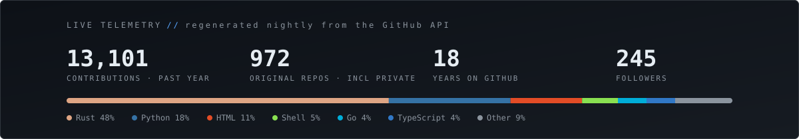

<picture>
  <source media="(prefers-color-scheme: dark)" srcset="assets/header.svg"/>
  <source media="(prefers-color-scheme: light)" srcset="assets/header-light.svg"/>
  
</picture>

<h2 align="center">A vibe is not a verdict.</h2>
<p align="center">
  Models write fluent code and confident answers. Fluent isn't proven.<br/>
  I build the deterministic tools that check — exact math, formal specifications, reproducible evidence —<br/>
  so what an AI produced can be verified instead of trusted.
</p>

<p align="center">
  <a href="https://copyleftdev.github.io">copyleftdev.github.io</a> ·
  <a href="https://dev.to/copyleftdev">dev.to</a> ·
  <a href="https://www.linkedin.com/in/donscv/">linkedin</a> ·
  <a href="mailto:don@codetestcode.io">don@codetestcode.io</a>
</p>

---

## Flagship: [tlatools-rs](https://github.com/copyleftdev/tlatools-rs)

**Ask a TLA+ specification about a state, and get an answer.** A parser and evaluator for TLA+ in Rust — not a model checker. Hand it a trace from production or a step from your implementation, and it tells you whether the spec permits it, and *which conjunct* refused it.

```console
$ tlatools check job.json
no action of the specification takes [...] to [...]. The closest was
`BecomeLeader(c = "s1")`, which was not available here:
`Cardinality(votesGranted[c]) * 2 > Cardinality(Server)` does not hold
(3 of its 4 conjuncts hold)
```

Reads **1,256 of 1,258** specifications across three public TLA+ corpora; the two it rejects, SANY rejects too. No JVM. [`cargo install tlatools`](https://crates.io/crates/tlatools)

## The same idea, applied elsewhere

| Repository | What it makes checkable |
|:-----------|:------------------------|
| [agent-calc](https://github.com/copyleftdev/agent-calc) | An agent's arithmetic — exact, typed JSON math instead of a model's guess at a number |
| [solve-score](https://github.com/copyleftdev/solve-score) | Exploit-difficulty scoring — an independent SOLVE v0.5 implementation that reproduces all 16 published calibration assessments |
| [anomalyx](https://github.com/copyleftdev/anomalyx) | Anomaly claims — contract-first detection across ~30 log, network and data formats; deterministic, mutation-tested |
| [whatthediff](https://github.com/copyleftdev/whatthediff) | Drift across N files — consensus, outliers and variant families, every finding backed by evidence |
| [entropyx](https://github.com/copyleftdev/entropyx) | A codebase's history — a forensic instrument for who changed what, how, and how it is holding up |
| [vajra](https://github.com/copyleftdev/vajra) | Structured data — deterministic reduction that breaks the noise and preserves what's true |

**Writing on it:** [Vibe Coding with Intent](https://dev.to/copyleftdev/vibe-coding-with-intent-a-testers-perspective-3f5d) · [Vibe Was Never the Problem](https://dev.to/copyleftdev/vibe-was-never-the-problem-the-missing-half-of-vibe-coding-50mi) · [A Vibe Is Not a Verdict](https://dev.to/copyleftdev/a-vibe-is-not-a-verdict-i-built-a-tool-thats-allowed-to-say-i-dont-know-4foe)

---

## About

Systems engineer on GitHub since 2008, Rust-first with production work in Zig, Go, Python and TypeScript. My background is testing and security research, which is where the habit comes from: a claim isn't done until something other than its author can check it. Everything ships as a small single binary with minimal dependencies, and the gate is mutation testing, not coverage.

<picture>
  <source media="(prefers-color-scheme: dark)" srcset="assets/metrics.svg"/>
  <source media="(prefers-color-scheme: light)" srcset="assets/metrics-light.svg"/>
  
</picture>

---

## Recently Shipped

<!--RECENT:START-->
| Repository | Description | Lang | Last push |
|:-----------|:------------|:----:|:----------|
| [leet-index](https://github.com/copyleftdev/leet-index) | Activity-aware rankings for US-based GitHub developers, with transparent scoring and… | $\texttt{JavaScript}$ | 2026-10-26 |
| [braess-router](https://github.com/copyleftdev/braess-router) | Bounded semantic routing with Jev and Poise. Rust, single-server, alpha. | $\texttt{Rust}$ | 2026-10-25 |
| [copyleftdev.github.io](https://github.com/copyleftdev/copyleftdev.github.io) | Canonical, self-regenerating identity page for copyleftdev — schema.org Person, llms.txt, and… | $\texttt{HTML}$ | 2026-10-25 |
| [kilo-data](https://github.com/copyleftdev/kilo-data) | Open threat-intelligence and IP-reputation ETL for phishing and abuse screening, with BGP and… | $\texttt{Rust}$ | 2026-10-25 |
| [vulngraph-data](https://github.com/copyleftdev/vulngraph-data) | Deterministic data pipeline for VulnGraph — ingests 11 vulnerability sources, publishes… | $\texttt{Rust}$ | 2026-10-25 |
| [seuil-rs](https://github.com/copyleftdev/seuil-rs) | A complete, safe JSONata implementation in Rust — JSON query, transform, and expression… | $\texttt{Rust}$ | 2026-10-23 |
<!--RECENT:END-->

<sub>This section and the metrics panel above are regenerated nightly by [a stdlib-only Python script](scripts/generate_profile.py) querying the GitHub API — no third-party stats services, nothing to go stale.</sub>

---

<details>
<summary><b>Everything else</b> — security tooling, systems utilities, agent infrastructure, and the absurd</summary>

### Security & Detection

| Repository | Description | Language |
|:-----------|:------------|:--------:|
| [floq](https://github.com/copyleftdev/floq) | C2 beacon detection via Floquet spectral analysis — pcap, live capture, or OTLP; 274 KB binary | $\texttt{Zig}$ |
| [fatt](https://github.com/copyleftdev/fatt) | Distributed async scanner for exposed files across millions of domains | $\texttt{Rust}$ |
| [fuf](https://github.com/copyleftdev/fuf) | Fast next-generation web fuzzer | $\texttt{Rust}$ |
| [robin-smesh](https://github.com/copyleftdev/robin-smesh) | Decentralized dark web OSINT framework — Tor crawling, artifact extraction | $\texttt{Rust}$ |
| [mini-shai-hulud-dragnet](https://github.com/copyleftdev/mini-shai-hulud-dragnet) | Forensic dataset + live dashboard for the 2026 npm supply-chain worm — 1,117 dropbox repos, 47 IOCs | $\texttt{Shell}$ |

### Systems & Developer Tools

| Repository | Description | Language |
|:-----------|:------------|:--------:|
| [tailx](https://github.com/copyleftdev/tailx) | Live system cognition engine — `tail` reimagined: anomalies, traces, structured JSON; 144 KB | $\texttt{Zig}$ |
| [coelacanth](https://github.com/copyleftdev/coelacanth) | AI-first Unix primitives, clean-room reimplemented under one machine-checkable contract | $\texttt{Zig}$ |
| [palimpsest](https://github.com/copyleftdev/palimpsest) | Deterministic crawl kernel — same seed, identical crawl; JA3/JA4 impersonation, WARC++ | $\texttt{Rust}$ |
| [hook-bin](https://github.com/copyleftdev/hook-bin) | Single-binary webhook inbox — embedded SQLite, live dashboard, zero deps | $\texttt{Rust}$ |
| [zgrok](https://github.com/copyleftdev/zgrok) | Self-hosted ngrok alternative built on Tokio | $\texttt{Rust}$ |
| [cora](https://github.com/copyleftdev/cora) | Multi-pattern fixed-string matcher — Aho-Corasick + SIMD on mmap'd files, NDJSON output | $\texttt{Rust}$ |

### AI & Agent Infrastructure

| Repository | Description | Language |
|:-----------|:------------|:--------:|
| [smesh-rust](https://github.com/copyleftdev/smesh-rust) | Decentralized coordination protocol for multi-agent LLM systems — QUIC P2P, sub-µs signal diffusion | $\texttt{Rust}$ |
| [sigmos](https://github.com/copyleftdev/sigmos) | DSL for defining AI-native, composable, reactive systems | $\texttt{Rust}$ |
| [mcp-flow](https://github.com/copyleftdev/mcp-flow) | WebTransport binding for MCP — QUIC streams, no head-of-line blocking | $\texttt{Multi}$ |
| [toon-zig](https://github.com/copyleftdev/toon-zig) | TOON (Token-Oriented Object Notation) — 30–60% token reduction for LLMs | $\texttt{Zig}$ |

### Education & the Absurd

| Repository | Description | Language |
|:-----------|:------------|:--------:|
| [humanlang](https://github.com/copyleftdev/humanlang) | Token bucket rate limiter implemented in 37 languages (1957–2016) | $\texttt{Multi}$ |
| [git-archaeology-lab](https://github.com/copyleftdev/git-archaeology-lab) | Hands-on exercises for forgotten git commands — crafted history, real bugs, real bisect targets | $\texttt{Shell}$ |
| [gitfoo_episode_1](https://github.com/copyleftdev/gitfoo_episode_1) | Git Black Belt Masterclass — the other 90% of git most devs never use | $\texttt{Python}$ |
| [OverHelloWorld](https://github.com/copyleftdev/OverHelloWorld) | Intentionally over-engineered Hello World — DDD, CQRS, event sourcing, telemetry | $\texttt{Go}$ |
| [fafoaas](https://github.com/copyleftdev/fafoaas) | FAFO as a Service — spec-first engineering masterclass; AsyncAPI 3 + MCP, 98/98 mutation score | $\texttt{TS}$ |
| [tip-to-tip-efficiency](https://github.com/copyleftdev/tip-to-tip-efficiency) | Mathematically serious crate for a deeply unserious Silicon Valley efficiency empire | $\texttt{Rust}$ |

</details>

---

<p align="center">
  If any of this saved you time, you can fund the compute behind it — tips become AI inference credit.<br/>
  <a href="https://tokentip.to/@copyleftdev">
    
  </a>
  · <a href="https://www.gitmesh.app/">gitmesh.app</a>
</p>

<a href="https://gitroll.io/profile/uB8fjxzB4NHUkjkK1pggNJbWLqz93">
  <picture>
    <source media="(prefers-color-scheme: dark)" srcset="https://gitroll.io/api/badges/profiles/v1/uB8fjxzB4NHUkjkK1pggNJbWLqz93?theme=dark"/>
    
  </picture>
</a>

<picture>
  <source media="(prefers-color-scheme: dark)" srcset="https://raw.githubusercontent.com/copyleftdev/copyleftdev/output/github-snake-dark.svg"/>
  
</picture>
